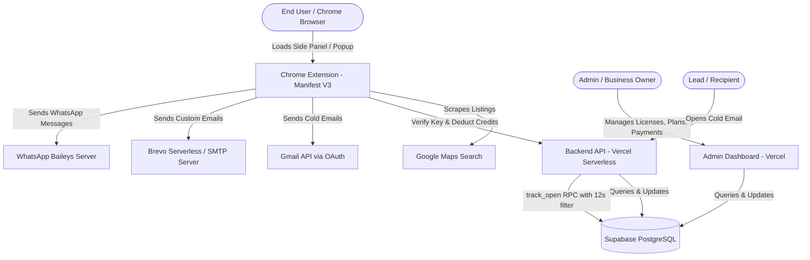

# ClientOutfy — System Architecture & Technical Specifications

ClientOutfy (formerly LeadOutfy) is an enterprise-grade Lead Generation, Google Maps Data Extraction, and Multi-Channel Cold Outreach SaaS ecosystem.

---

## Component Breakdown

### 1. `apps/chrome-extension`
- **Manifest Version:** Manifest V3
- **Primary Features:**
  - Non-stop 24-hour Google Maps background scraper.
  - Side Panel integration (`chrome.sidePanel`) with intuitive tabs: Hunt, Results, Export, Import, WhatsApp, Email, Account, Settings, Guide.
  - Scanner overlay displaying live lead harvesting statistics over Google Maps.
  - Geo-targeting presets via `cities.js` containing categorized international and domestic cities.
  - Client-side Excel (`.xlsx`) generation and parsing with `xlsx_mini.js`.
  - Gmail OAuth integration (`https://www.googleapis.com/auth/gmail.send`).

### 2. `apps/admin-dashboard`
- **Stack:** Pure HTML5, CSS3 with modern glassmorphism/dark theme, vanilla JavaScript, Supabase JS Client v2.
- **Hosting Target:** Vercel (Static Hosting).
- **Core Modules:**
  - **Dashboard:** Revenue stats, license counters, pending payments alerts.
  - **Payments:** Verification of bKash, Nagad, Rocket, or Bank transactions with one-click license key approval.
  - **Licenses:** Key generation, plan assignment, credit allocations, instant blocking/unblocking, expiry tracking.
  - **Customers:** Database of clients, phone numbers, and usage histories.
  - **Settings:** Admin credentials, mobile payment numbers, subscription plan pricing, and credit quotas.

### 3. `apps/backend-api`
- **Stack:** Node.js 20.x ES Modules on Vercel Serverless Functions.
- **Key Endpoints:**
  - `POST /api/verify`: Authenticates license keys, checks active status and expiration dates.
  - `POST /api/deduct`: Atomically decrements user credit quotas via the `deduct_credit` Supabase RPC function.
  - `POST /api/track`: Logs email dispatch events with recipient, channel, and subject details.
  - `GET /api/t/open?id=<tracking_id>`: Serves a 1x1 transparent GIF tracking pixel with a 12-second anti-bot prefetch barrier.
  - `GET /api/stats`, `GET /api/stats-buckets`, `GET /api/daily`: Aggregates email delivery, open, and response rates.

### 4. `apps/whatsapp-server`
- **Stack:** Node.js, Express, `@whiskeysockets/baileys`, QR Code terminal/web generation.
- **Hosting Target:** Render, Railway, or VPS.
- **Key Capabilities:**
  - Human-like typing simulations and variable delays to safeguard against account restrictions.
  - Automated voice note delivery (`audio/mp3` to `audio/ogg; codecs=opus`).
  - Auto-read mechanism and persistent session management.

### 5. `apps/email-server-brevo` & `apps/email-server-smtp`
- **Brevo API (Vercel Serverless):** Secure API key encapsulation, preventing client-side credential exposure with automatic request retry logic.
- **Nodemailer SMTP (Express):** Universal SMTP integration supporting cPanel, Hostinger, Zoho, Outlook, and Gmail SMTP servers.

### 6. `database/`
- **Database Engine:** PostgreSQL via Supabase.
- **Key Schemas:** `licenses`, `payments`, `plans`, `admins`, `settings`, `email_events`.
- **Stored Procedures:** `deduct_credit`, `track_open`, `email_stats`, `email_stats_buckets`, `email_daily`.
